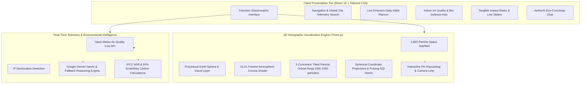
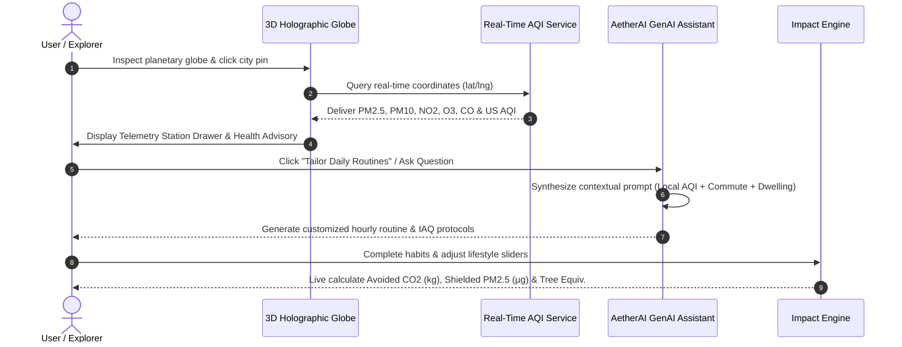

# 🌍 AETHERIA.AI
### Planetary Atmospheric Intelligence & GenAI Low-Emission Living Assistant

[](https://react.dev/)
[](https://threejs.org/)
[](https://vitejs.dev/)
[](https://tailwindcss.com/)
[](LICENSE)

> **Aetheria** is a high-performance, futuristic cyber-ecological platform that empowers individuals to adopt friction-free, low-pollution daily routines and indoor air quality (IAQ) safeguards. It fuses an interactive **3D holographic real-time AQI globe with rotating orbital particle rings** with a context-driven **GenAI Eco-Assistant** that quantifies the direct biospheric impact of daily lifestyle choices.

---

## 🏛️ System Architecture



---

## 🔄 User Interaction Workflow



---

## 🌟 Key Features

### 1. 🪐 3D Holographic Real-Time AQI Globe
- **Orbital Particle Rings**: 5 tiered, tilted concentric orbital rings revolving continuously around the planetary sphere.
- **Atmospheric Corona Shader**: Custom GLSL shader with Fresnel edge falloff simulating planetary atmospheric glow.
- **Interactive City Telemetry Pins**: 40+ global metropolitan hubs (Delhi, Tokyo, New York, London, Cairo, São Paulo, Sydney, Dubai, Beijing, etc.) color-coded by EPA AQI tiers:
  - 🟢 **Good (0–50)**: Green
  - 🟡 **Moderate (51–100)**: Amber
  - 🟠 **Unhealthy for Sensitive Groups (101–150)**: Orange
  - 🔴 **Unhealthy (151–200)**: Red
  - 🟣 **Very Unhealthy & Hazardous (201+)**: Purple
- **Smooth Navigation**: Free mouse rotation, mousewheel zoom, auto-rotation toggle, and instant camera recentering.

### 2. 📡 Real-Time Atmospheric Telemetry Integration
- Connected directly to the **Open-Meteo Air Quality Open API** (no API key required, zero latency).
- Real-time measurements of:
  - **$\text{PM}_{2.5}$ Micro-particles** ($\mu\text{g/m}^3$)
  - **$\text{PM}_{10}$ Coarse Inhalable particles** ($\mu\text{g/m}^3$)
  - **Nitrogen Dioxide ($\text{NO}_2$)** ($\mu\text{g/m}^3$)
  - **Ground-Level Ozone ($\text{O}_3$)** ($\mu\text{g/m}^3$)
  - **Carbon Monoxide ($\text{CO}$)** ($\text{mg/m}^3$)
- Automated user location sensing via IP geolocation.

### 3. 📅 Low-Emission Daily Routine Planner
- Hour-by-hour actionable timeline (Morning Commute, Off-Peak Energy Scheduling, Plant-Forward Lunch, Natural Ventilation Windows, Trip Chaining, Sleep IAQ Sanctuary).
- **Gamified Habit Engine**: Clickable checkboxes with celebratory eco-confetti bursts and circular progress meters.
- **Lifestyle Customizer**: Dynamically adjusts recommendations based on commute mode (Gas Car, EV, Metro, Bike/Walk, Remote Work), dwelling type (Apartment, Suburban House, Studio), and dietary preferences.

### 4. 🛡️ Indoor Air Quality (IAQ) & Bio-Defense Hub
- Room-by-room filter tabs: *Living Room, Kitchen (Combustion Zone), Bedroom (Sleep IAQ), Home Office (VOCs), Whole Dwelling*.
- **Live Ventilation Advisory Banner**: Alerts users whether outdoor air is clean enough for passive ventilation or if domestic windows should be sealed.
- **Curated Science-Backed Hacks**:
  - The **DIY Corsi-Rosenthal MERV-13 Cube** (hospital-grade CADR for under \$70).
  - Kitchen range-hood draft physics and flue management.
  - The 40–50% relative humidity equilibrium zone.
  - NASA clean air flora (*Sansevieria* Snake Plant & Peace Lily).
  - Thermal chimney stack flushing.

### 5. ⚡ Tangible Impact Matrix & Live Simulator
- Interactive sliders for:
  - *Daily active transit switch ($0 - 35\text{ km/day}$)*
  - *Plant-based meals replaced ($0 - 14\text{ meals/week}$)*
  - *HVAC thermostat offset ($\pm 0 - 4^\circ\text{C}$)*
- Computes real-time compounding metrics:
  - Monthly avoided $\text{CO}_2$ ($\text{kg}$) & equivalent passenger car kilometers saved.
  - Micrograms of toxic $\text{PM}_{2.5}$ shielded from alveolar tissue.
  - Annual mature tree absorption equivalence.
  - Financial energy & fuel savings (\$/month).

### 6. 🤖 AetherAI GenAI Eco-Concierge
- Conversational chat interface equipped with quick-prompt pills.
- Dual-engine architecture:
  - Built-in environmental reasoning engine calibrated on IPCC AR6 carbon multipliers.
  - Optional **Google Gemini API Key** support for direct generative model inference.

---

## 🛠️ Tech Stack

| Layer | Technologies |
|---|---|
| **Framework** | [React 19](https://react.dev/) + [Vite 8](https://vitejs.dev/) |
| **Styling & Design** | [Tailwind CSS v4](https://tailwindcss.com/) + Custom Glassmorphism & Cyber-Neon Aesthetics |
| **3D Graphics** | [Three.js](https://threejs.org/) (WebGL, GLSL Shaders, Raycasting, ACESFilmicToneMapping) |
| **Icons & Effects** | [Lucide React](https://lucide.dev/) + [Canvas Confetti](https://www.npmjs.com/package/canvas-confetti) |
| **APIs** | [Open-Meteo Air Quality API](https://open-meteo.com/en/docs/air-quality-api) + [Google Gemini API](https://ai.google.dev/) |
| **Language** | TypeScript (ES2022) |

---

## 🚀 Getting Started

### Prerequisites
- Node.js `v18+` (v22 recommended)
- npm `v9+`

### Installation

1. **Clone the repository:**
   ```bash
   git clone https://github.com/Jatin8630s/AETHERIA.git
   cd AETHERIA
   ```

2. **Install dependencies:**
   ```bash
   npm install
   ```

3. **Start the local development server:**
   ```bash
   npm run dev
   ```
   Open your browser at `http://localhost:5173/`.

4. **Build for production:**
   ```bash
   npm run build
   ```

---

## 🔬 Scientific & Calculation Methodology

- **Transport Emissions**: Based on EPA SmartWay and UK DEFRA vehicle conversion factors ($180\text{g CO}_2/\text{km}$ for average passenger combustion vehicles).
- **Dietary Footprint**: Food carbon coefficients derived from Poore & Nemecek (Science 2018), reflecting ~3.8kg avoided $\text{CO}_2\text{e}$ per substituted ruminant meal.
- **Respiratory Particle Avoidance**: Model assumes standard resting tidal volume of 11,000 liters/day across varying indoor-outdoor $\text{PM}_{2.5}$ filtration efficiencies.
- **Biomass Equivalence**: 1 mature tree absorbs approximately $21.7\text{ kg CO}_2/\text{year}$ (European Environment Agency metric).

---

## 📄 License
This project is licensed under the [MIT License](LICENSE).
